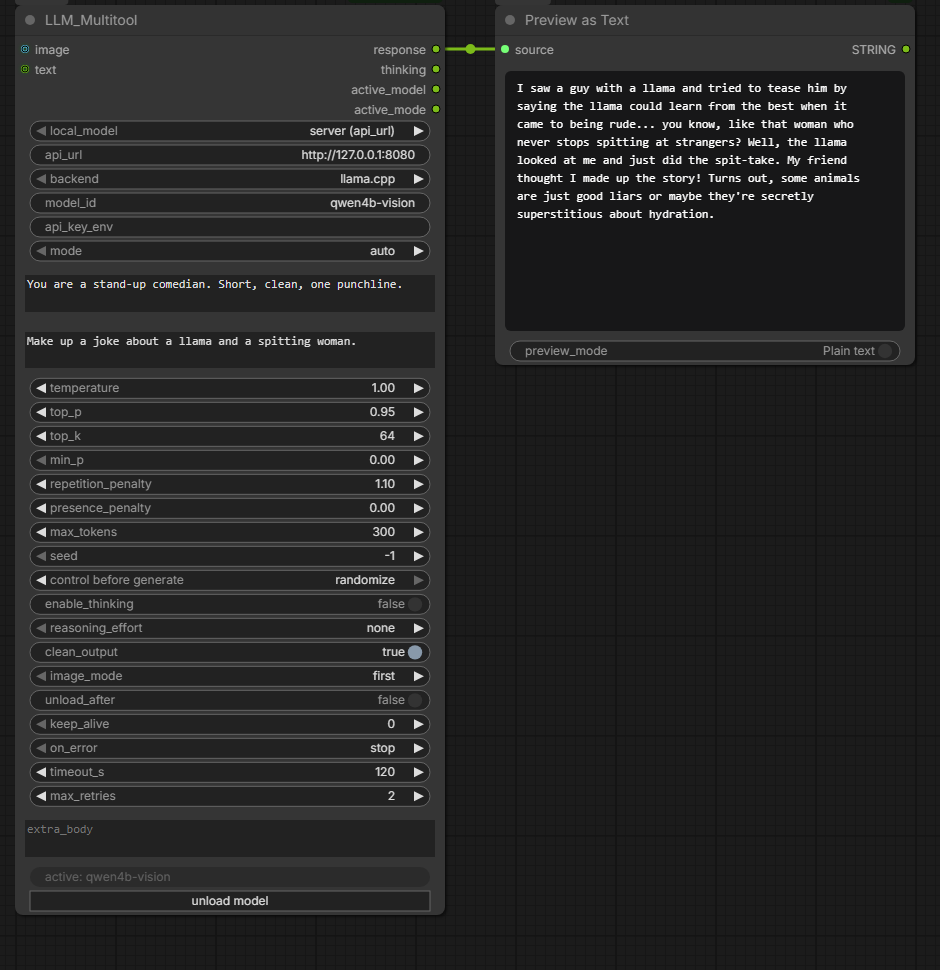

<p align="center">
  
</p>

<h1 align="center">LLM_Multitool for ComfyUI</h1>

<p align="center">
  Run a local vision LLM inside ComfyUI without installing anything extra,<br>
  and get your VRAM back for rendering with one click.
</p>



One node for image and text prompts. Pick a GGUF from the dropdown and the node starts
its own `llama-server`, or point it at a server you already run: llama.cpp (also as a
router), Ollama, LM Studio, vLLM, Unsloth Studio or any OpenAI-compatible API.

## Why this node

- **Local model from a dropdown.** No `llama-cpp-python`, no compiler: the node starts a
  `llama-server` binary with the GGUF you pick and pairs its `mmproj` for vision.
- **VRAM on demand.** `unload model` button on the node, `unload_after` per run, and
  automatic unload after 5 min idle. Works for the own server, llama.cpp routers and Ollama.
- **Safe by default.** Errors stop the queue instead of turning into your image prompt,
  API keys never end up in the workflow, `api_url` typos are fixed, every input has
  hover help.
- **Light.** One node, needs only `numpy`, `Pillow`, `requests` (already in ComfyUI).

## Quick start

```
cd ComfyUI/custom_nodes
git clone https://github.com/metamountain/LLM-Multitool-ComfyUI llm_multitool
```

1. Get a `llama-server` with vision support from
   [llama.cpp releases](https://github.com/ggml-org/llama.cpp/releases) and put it on
   `PATH`, or set its full path in your ComfyUI start script:
   ```
   set LLAMA_SERVER_BIN=C:\llama.cpp\llama-server.exe
   ```
2. Download a small vision model (3.6 GB in total), for example
   [unsloth/Qwen3.5-4B-GGUF](https://huggingface.co/unsloth/Qwen3.5-4B-GGUF):
   ```
   hf download unsloth/Qwen3.5-4B-GGUF Qwen3.5-4B-UD-Q4_K_XL.gguf mmproj-F16.gguf
   ```
3. Restart ComfyUI, add **LLM_Multitool** (category *LLM*), connect an image and pick
   the model in `local_model`. On an RTX 4090 a description takes about 0.5 s; the first
   run adds a few seconds for loading.

## Model list (`local_model`)

The dropdown shows every GGUF found in the Hugging Face cache and in ComfyUI's
`models/LLM`, `models/text_encoders` and `models/clip` (including folders from
`extra_model_paths.yaml`).

- With an `mmproj*.gguf` in the same folder the model can see images.
- Without one it is listed as `<name> (text)` and runs text only.
- Draft heads (MTP, DFlash) and encoder-only files (T5) are left out.
- `.safetensors` files cannot be used; `llama-server` needs GGUF.
- `server (api_url)` uses the server at `api_url` instead.

The node's own server runs on port 8081 and is shared by all LLM_Multitool nodes.
Switching models restarts it. A workflow that names a model missing on your machine
still loads; the node only reports it when it runs.

## Freeing VRAM

| Setup | `unload model` button / `unload_after` |
|---|---|
| `local_model` = a GGUF | stops the own server on port 8081 |
| llama.cpp router at `api_url` | `POST /models/unload` for the loaded model |
| `ollama` | `keep_alive 0` for the loaded models |
| `openai`, `unsloth`, plain llama-server | nothing to unload (shown in `active`) |

The `active` field under the inputs shows which model answered the last run, or what
the button did.

## Typical setups

| Goal | Connect | Set |
|---|---|---|
| Describe an image, local model | `image` <- Load Image | `local_model` |
| Describe an image, own server | `image` <- Load Image | `api_url`, `backend` |
| Rewrite / expand a prompt | `text` <- prompt or other LLM | `{text}` in `user_prompt` |
| Feed a sampler | `response` -> CLIP Text Encode | `clean_output` on |
| Cloud API | - | `backend` = `openai`, `api_url`, `model_id`, `api_key_env` |

## Inputs

| Group | Inputs |
|---|---|
| Model | `local_model`, `api_url`, `backend` (`llama.cpp` / `ollama` / `openai` / `unsloth`), `model_id` (`auto` = ask the server), `api_key_env` |
| Prompt | `mode` (`auto` / `vision` / `text`), `system_prompt`, `user_prompt` (`{text}` = text socket) |
| Sampling | `temperature`, `top_p`, `top_k`, `min_p`, `repetition_penalty`, `presence_penalty`, `max_tokens`, `seed` (-1 = new answer every run) |
| Thinking | `enable_thinking`, `reasoning_effort` |
| Output / VRAM | `clean_output`, `image_mode` (`first` / `all`, up to 8), `unload_after`, `keep_alive` (Ollama) |
| Safety | `on_error` (`stop` / `return text`), `timeout_s`, `max_retries` |
| Expert | `extra_body` (JSON merged into the request last) |
| Sockets | `image` (IMAGE), `text` (STRING) |

Outputs: `response`, `thinking`, `active_model`, `active_mode`.

## API keys

Keys are never stored in the workflow. Set the key in your ComfyUI start script and enter
only the variable **name** in `api_key_env`:

```
set OPENAI_API_KEY=sk-...
```

The node refuses a value that looks like a key instead of a name.

## Environment variables

| Variable | Default | |
|---|---|---|
| `LLAMA_SERVER_BIN` | `llama-server` on PATH | server binary |
| `LLM_MULTITOOL_PORT` | `8081` | port of the own server |
| `LLM_MULTITOOL_CTX` | `16384` | context size of the own server |
| `LLM_MULTITOOL_LOAD_S` | `300` | max seconds to wait for a model to load |

Set them in the script you start ComfyUI with. A restart from inside ComfyUI (for
example ComfyUI-Manager's *Restart*) may not keep them; start ComfyUI from the script
again if a variable seems missing.

## When something goes wrong

With `on_error` = `stop` (default) an error stops the queue with a red message.

| Message | Fix |
|---|---|
| `llama-server not found` | Put it on `PATH` or set `LLAMA_SERVER_BIN`, then start ComfyUI from that script |
| `Cannot reach http://...` | Start the server, or pick a `local_model` |
| `has no /v1/models -- wrong 'backend'?` | Choose the `backend` that matches the server |
| `Router has no model loaded` | Load one on the router or enter its id in `model_id` |
| `Server lists no model` / `Ollama lists no model` | Load a model / `ollama pull <name>` |
| `401 Unauthorized` / `Environment variable 'X' is not set` | Set the key variable in the start script and restart ComfyUI |
| `is text only` / `400 ... mmproj` | The model cannot see images; pick one with `mmproj` |
| `Empty response -- max_tokens was used up` | Raise `max_tokens` or turn `enable_thinking` off |
| `extra_body is not valid JSON` | Use double quotes: `{"top_k": 20}` |
| `local_model` exits right away | Old llama.cpp build; the message shows the last log lines |

Tested on Windows with llama.cpp, a llama.cpp router and the node's own server.
Linux and macOS should work but are untested.
